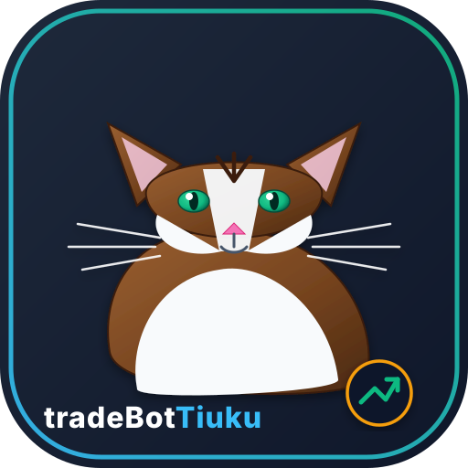

# 🐱 tradeBotTiuku — Avointen Lähteiden Salkunneuvonantaja & Advisory AI Agent



**tradeBotTiuku** on monipuolinen, Python-pohjainen ja paikallisesti toimiva salkunseuranta-, mikroyhtiöseulonta- ja uudelleentasapainotuksen neuvonantaja-agentti. Tiuku toimii täysin itsenäisenä **avointen lähteiden markkina-älyagenttina (Advisory Agent)**. Järjestelmä yhdistää teknisen analyysin, fundamentti-NLP-tilinpäätöslukijan, monikielisen reaaliaikaisen uutistarkistuksen (Suomi, Ruotsi, USA) sekä modernin interaktiivisen Streamlit-hallintapaneelin ihmisen hyväksyttäväksi (*Human-in-the-loop*).

---

## 🌟 Tärkeimmät Ominaisuudet

### 1. 🖥️ Interaktiivinen Streamlit-Hallintapaneeli & Yhdistetty Käynnistys
- **Yhdistetty Pikakäynnistys (UI + Paper Trader)**:
  - `start_all.bat` tai `.\start_all.ps1` tai `python start_all.py`
  - Käynnistää sekä Streamlit-hallintapaneelin että reaaliaikaisen Paper Trader -daemonin yhdellä komennolla ja hallitsee molempien prosessien siistiä sammutusta (`Ctrl+C`).
  - *Oletustila (`--schedule`)*: Sisäänrakennettu koodiajastin ajaa päivittäisen iltasyklin klo `23:05` markkinoiden sulkeuduttua (Nordic & US EOD) ilman erillisiä cron-ajastuksia. Kaikki analyysi tapahtuu puhtaasti End-Of-Day (EOD) -pohjaisesti ilman intraday-markkinaskannausta.
  - *Parametrit*: `--schedule` (oletus), `--daily-at <HH:MM>` (oletus: 23:05), `--loop --interval-hours <h>` (perinteinen silmukkatila), `--run-once` (yksi ajo), `--ui-only` (vain UI), `--daemon-only` (vain daemon), `--port <port>` (oletus: 8502).
  - *Atomiset JSON-tallennukset (`_atomic_write_json` & `_safe_load_json_list`)*: Kaikki salkkujen tila- ja historiatiedostot (`*_state.json`, `*_history.json`) kirjoitetaan atomisesti PID-kohtaisen väliaikaistiedoston ja `os.replace`-kutsun kautta sekä suojataan automaattisella regex-elvytyksellä, mikä estää rinnakkaisten luku-/kirjoitusoperaatioiden aiheuttamat JSON-katkeamiset ja historian nollautumiset.
- **Pelkkä Käyttöliittymä**: `streamlit run dashboard.py --server.port 8502`
- **Pelkkä Paper Trader Daemon (Koodiajastin / Linux)**: `python main_controller.py --schedule --daily-at 23:05`
- 🐧 **Linux-palvelinasennus & systemd-daemon**: Täydellinen asennusopas ja valmiit palvelupohjat löytyvät dokumentista: [docs/LINUX_DAEMON_OHJEET.md](docs/LINUX_DAEMON_OHJEET.md).
- **Saumaton Taustapäivitys Ilman Harmaantumista (`st.fragment` & Anti-Dimming CSS)**: Hyödyntää moduulitason staattisia `@st.fragment`-kääreitä ja räätälöityä CSS-koodia, joka estää Streamlitin himmenemisen / latauspeitteen automaattisen päivityksen aikana.
- **Selkeät Välilehdet**:
  - 📋 **Seulonnan Tulokset**: Suodatettava ja haettava taulukko analysoiduista raporteista, Suomen aikavyöhykkeen aikaleimoilla (`DD.MM.YYYY HH:MM:SS`), profiileilla ja tuomioilla (🔥 *STRONG BUY*, 👀 *WATCH_TURNAROUND*, 🟡 *HOLD*, ❌ *REJECT*).
  - 👀 **Turnaround-Seurantalista (`watchlist_turnarounds.csv`)**: Yhtiöt, joissa on havaittu reaaliaikaisia positiivisia käännekatalyyttejä (*suurtilaukset, yrityskaupat, velkajärjestelyt, uusi johto*). Seurantalistaa voi hallinnoida suoraan näkymästä (`🗑️ Poista listalta`).
  - 🔎 **Live Ticker Scanner**: Yksittäisen osakkeen ad-hoc-pikatarkistus (fundamenttiluvut, uutistarkistus ja Dual-Step -tuomio). Havaitut turnaround-kandidaatit voidaan tallentaa suoraan yhdellä klikkauksella Turnaround-seurantalistalle (`➕ Tallenna Turnaround Watchlistiin`).
  - 📊 **ETF-Seuranta**: Buy the Dip -indikaattorit ja kuukausisäästön allokaatio.
  - 💼 **Salkun Yhteenveto & Paper Trading Portfolio (`data/open_positions.csv`)**: Reaaliaikaiset spot-hinnat, automaattiset FX-valuuttakurssimuunnokset (EUR), avoin PnL (€ ja %), salkun kokonaisarvo ja käteissaldo, tilastollinen KPI-yhteenveto. **Reaaliaikainen markkinapohjainen salkkurekonstruktio (`compute_live_portfolio_history`)**: salkun tuottokäyrää ei enää lueta pelkistä staattisista JSON-tallenteista, vaan se rekonstruoidaan suoraan salkun avointen osakkeiden todellisista historiallisista päätöskursseista (`yfinance`, 1h ja 1d -palkit, valuuttamuunnokset EUR). Näin graafi heijastaa aina 100 % tarkasti osakkeiden todellista kurssikehitystä ilman teennäisiä tasoheilahteluita. Valittavissa aikavälit (24h, 7d, 30d, 3kk, kaikki historia), resoluutiot (tunti 1h, kaikki mittauspisteet, päivä 1d, viikko 1vk, kuukausi 1kk) ja mittarit (kokonaisarvo €, tuotto € / %, käteinen vs. osakkeet). **Kaikissa graafeissa esitetään reaaliaikaiset aikaleimat**: graafin päivityshetki (`🕒 Päivitetty`), mittauspisteen tai markkinanoteerauksen uusin aikaleima (`📅 Uusin data`) sekä moottorimerkintä (`📡 Moottori`).
  - 📱 **Mobiili- & Selaintuki ja Responsiivinen Salkunvalinta**:
    - **Pikasalkunvalitsin päänäkymässä**: Paper-salkun (P1–P12) voi valita ja selata suoraan päänäkymän yläreunasta pudotusvalikolla tai `◀ Edellinen` / `Seuraava ▶` -pikapainikkeilla ilman vasemman reunan sivupalkin avaamista. Valinta on täysin kaksisuuntaisesti synkronoitu sivupalkin kanssa, joten selain-/työpöytäkäyttö säilyy koskemattomana.
    - **Selkeä & Responsiivinen Salkkuvertailu (`Salkkuvertailu (Kaikki)`)**: Kuvaajan sivumarginaalit ja vaakasuuntainen alapuolinen selite on optimoitu siten, että mobiililaitteilla käyrät hyödyntävät koko ruudun leveyden ilman tiukkaan puristumista. Pikavalinnat (*Kaikki salkut, ⭐ Vain aktiivinen, 🏆 Top 3 + Aktiivinen, Mukautettu valinta*), aikavälin pikanapit (*7 pv, 14 pv, 30 pv, Kaikki*) sekä mobiiliystävällinen tooltip tekevät vertailusta selkeää ja luettavaa niin puhelimella kuin tietokoneellakin.
  - 🪙 **Token-Laskuri & Kustannusseuranta**: Reaaliaikainen syöte-/tuotostokenien laskenta, pyyntömäärät, arvioitu dollarikulu ja jäljellä oleva analyysikapasiteetti.
  - ⚙️ **Massa-ajon Hallinta**: Suora käynnistyspainike raporteille valinnaisella reaaliaikaisella web-uutistarkistuksella.

---

### 2. 🔍 Dual-Lens Mikroyhtiöseulonta & Massa-analyysi (`batch_processor.py`)
> *Yksityiskohtainen kuvaus poimintalogiikasta löytyy dokumentista: [docs/OSAKEPOIMINTALOGIIKKA.md](docs/OSAKEPOIMINTALOGIIKKA.md). Täydellinen testausmetodologia ja tulokset on koottu raporttiin: [docs/BACKTEST_RAPORTTI.md](docs/BACKTEST_RAPORTTI.md).*

- **Mikroyhtiöuniversumin Eristys (`scripts/clean_universe_builder.py`) & Dynaaminen Universumipäivitys (`screener/dynamic_universe_updater.py`)**:
  - Hakee reaaliaikaiset FX-kurssit ja suodattaa osakeuniversumin tiukasti alle $300M USD markkina-arvoon (`< $300M USD`) estäen suuryhtiökontaminaation.
  - **Tiukat likviditeetti- ja senttiosakesuodattimet**: Hylkää osakkeet, joiden hinta on alle 0.10 (paikallisessa valuutassa) tai joiden 20 päivän keskimääräinen päivävaihto (20d ADV) on alle $50,000 USD, karsien epälikvidit tilauskirjat ja sub-penny -ansat puhtaaseen laatulikvidin mikroyhtiön universumiin (US, FI, SE).
  - **Automaattinen Viikkosynkronointi (Nordnet & yfinance)**: Skannaa 7 päivän välein (tai `--sync-universe` -lipulla / Dashboardin pikapainikkeella) Nordnetin rajapinnasta uudet listautujat (esim. uudet First North / Spotlight -yhtiöt). Jos uuden tulokkaan 20d ADV ylittää 50 000 € / $50k ja hinta $\ge$ 0,10, se lisätään atomisesti `clean_microcap_universe.csv`:hen ja otetaan automaattisesti mukaan kaupankäyntiin. Tila tallennetaan tiedostoon `data/universe_sync_status.json`.
  - Päivitetty **Profile A (Quality Growth)**: vaatii liikevaihdon kasvun (> 20 %) ohella vahvaa myyntikatetta (> 40 %) ja eloonjäämistarkastuksen (positiivinen OCF tai kassariittävyys > 18 kk).

- **Yhdistetty Testipatteristo (`run_all_tests.py`)**:
  - Ajaa yhdellä komennolla kaikki 5 testausmoduulia (pytest, Lost in the Middle, Ground Truth, 2.5x ATR Trailing Stop-Loss ja Markkinavaikutus/DSR).

- **Kvantitatiivinen Fundamenttibäkkäri (`scripts/fundamental_backtester.py`)**:
  - Testaa historiallisesta tilinpäätösdatasta (yfinance) deterministiset kovat säännöt täysin erillään LLM:stä.
  - Arvioi kvartaalikohtaisesti Profile A (Kasvu: liikevaihto YoY > 20 %, myyntikate > 40 %, kassariittävyys) ja Profile B (Arvo: nettovelaton tase, Anti-Shrinking -sääntö).
  - Laskee automaattisesti 3 kk (~63 kaupankäyntipäivää) ja 6 kk (~126 kaupankäyntipäivää) toteutuneet tuotot, vertailuindeksin (esim. `^RUT`) tuoton, alfan sekä maksimilaskut (Max Drawdown).

- **LLM Ground Truth -testipatteri (`scripts/llm_truth_tester.py`)**:
  - Validoi laadullisen päättelyn ja determinististen turvaporttien toimivuuden tunnetuilla testiskenaarioilla (Ruotsin kontrollbalansräkning, ATM-diluutiokriisi, johdon ostot ja käännekatalyytti, rutiinikalenterit, hyperkasvuyhtiöt).
  - Vertaa LLM-tuomiota ja pedagogista perustelua odotettuun maaperätotuuteen (Ground Truth) ja tulostaa tarkan tarkkuusraportin.

- **Konteksti-ikkunan & 'Lost in the Middle' -Testipatteri (`scripts/context_window_tester.py`)**:
  - Testaa analyysiputken tarkkaavaisuutta ja kestävyyttä massiivisen 50-sivuisen (~7 000 – 30 000 tokenia) tilinpäätöksen keskelle (50 % kohta) upotettua kriittistä myrkkykapselia vastaan (*Ruotsin kontrollbalansräkning tai \$25M ATM-diluutio*).
  - Varmistaa, että petollisen hyvät kovat fundamenttiluvut eivät sokaise järjestelmää ohittamaan tekstin kriittisiä riskivaroituksia.

- **Institutionaalinen Harhaton Bäkkäri (`scripts/institutional_backtester.py`)**:
  - Eliminoi eloonjäämis- (survivorship bias) ja ennakkonäkemisharhan (look-ahead bias) lukemalla fundamentit puhtaasta **Point-in-Time** -tietokannasta (`data/clean_microcap_pit_fundamentals.csv`, 672 kvartaaliraporttia aikaväliltä 02/2025–09/2026) historiallisen kurssi- ja valuuttatiedon kera.
  - Simuloi 240 toteutunutta mikroyhtiökauppaa 69 eri yhtiölle ($N=240, N_{\text{eff}} \approx 69$) vähentäen **0.50 %** kulusuojan/slippagen.
  - Tuottaa kattavat institutionaaliset riskimittarit: keskituotto vs. mediaani (vinouden paljastamiseksi), Sharpe-luku (3 % Rf), volatiliteetti (Std Dev), keskimääräinen Max Drawdown sekä segmentoidut alfat suhteessa Russell 2000 (`^RUT`) -indeksiin.

- **2.5x ATR Trailing Stop-Loss -Simulaattori (`scripts/stop_loss_simulator.py`)**:
  - Simuloi mekaanisen 14 päivän 2.5x ATR dynaamisen liukuvan tappionpysäytyksen toteutusta fundamenttisignaaleille (`data/institutional_backtest_results.csv`).
  - Vertailee 6 kk Buy & Hold -tuottoa ja hallittua riskiä, rajoittaen suurimman tappion (-27.83 %) ja vapauttaen pääoman uusiin ideoihin (ka. pitoaika 26.9 pv).

- **👑 Oracle Benchmark (Omniscient Benchmark, `oracle_benchmark.py`)**:
  - Laskee teoreettisen maksimituoton (teoreettinen tuottokatto / vertailuline) historialliselle aikaikkunalle täydellisellä jälkiviisaudella, mutta **tiukasti realistisilla markkinamekaniikan rajoitteilla**:
    - **Pääoma & Slottikoko**: 10 000 € lähtöpääoma, enintään 5 yhtäaikaista positiota, tasan 2 000 € per slotti.
    - **Tiukka 2 % Likviditeettirajoite**: Oracle ei saa ottaa yli 2 % osakkeen toteutuneesta päivävaihdosta (`Close * Volume` EUR) ostopäivänä (jos 2 000 € > 2 % päivävaihdosta, kauppa hylätään epärealistisena).
    - **Realistiset Toteutushinnat & Splittikorjaus**: Ostot ja myynnit suoritetaan splittikorjattuun päätöskurssiin (`Adj Close`). Sisältää automaattisen käänteissplittien takautuvan korjauksen (`Ticker.splits`) sekä Sanity Filterin (hylkää epäilyttävät swingit, jos tuotto $> +400\%$ ja pitoajan ka. vaihto $< 50\,000$ €).
    - **Greedy Hindsight -optimointi**: Etsii universumin (`data/clean_microcap_universe.csv`) tuottavimmat päällekkäistymättömät noususwingit ja allokoi ne dynaamisesti 5 vapaaseen slottiin.
    - **Pääomakäyrä & Tulokset**: Laskee päivittäisen mark-to-market -pääoman ja tallentaa sen tiedostoon `data/oracle_equity_curve.csv` (`Date`, `Total_Equity`) sekä toteutuneet kaupat tiedostoon `data/oracle_trades.csv`.

- **Vaihe 0: Deterministinen Tase- ja Kassavirtalaskenta (`screener/financial_metrics_engine.py`)**:
  - Hakee taseen ja kassavirrat yfinancesta ja laskee kovat talousluvut (`net_cash`, `operating_cash_flow_ttm`, `cash_runway_months`, `revenue_growth_yoy_pct`) puhtaalla Pythonilla ennen LLM-kutsua.
  - Sisältää **Data Freshness Guard** -tarkistuksen (enintään 120 päivää vanha tilinpäätös, `DATA_STALENESS_WARNING`), joka suojaa vanhentuneen datan pohjalta syntyviltä ostoilta.
  - Syöttää luvut tekoälylle lohkossa `[HARD FINANCIAL FACTS - DO NOT RECALCULATE]`, jolloin LLM ei hallusinoi laskutoimituksia ja keskittyy laadulliseen analyysiin.
- **Vaihe 1: Fundamentti-NLP -analyysi (`screener/nlp_analyzer.py`)**:
  - **Profiili A (Hyper-Growth Tech / Micro-Cap)**: Skaalautuvat 10x-kandidaatit (korkea bruttokate, orgaaninen liikevaihdon kasvu, laajeneva TAM).
  - **Profiili B (Deep Value / Turnaround)**: Matala arvostus (P/B, EV/S), vahva tase, kassan riittävyys ja orgaaninen kannattavuuskäänne.
  - **Kovat Turvaportit**: Hylkää automaattisesti yhtiöt, joilla on jatkuva laimennusriski (*ATM-annit, toksiset vaihtovelkakirjat*), Ruotsin lain miinat (*kontrollbalansräkning, rekonstruktion*), epämääräiset liiketoimintakäännökset tai kassan loppuminen alle 6–12 kuukaudessa.
- **Vaihe 2: Markkinakohtainen Reaaliaikainen Uutis- ja Tiedotetarkistus (`screener/web_verifier.py`) & Pohjoismainen Valuuttatuki**:
  - **Automaattinen Markkinareititys & Valuuttamuunnokset**: Tunnistaa Suomen (`.HE`, EUR), Ruotsin (`.ST`, SEK), Tanskan (`.CO`, DKK), Norjan (`.OL`, NOK) sekä Yhdysvaltain (`US`, USD) osakkeet ja konvertoi kaikki reaaliaikaiset osto- ja myyntikurssit sekä PnL-laskennat automaattisesti salkun perusvaluuttaan (EUR).
  - **Lokalisoitu Google News RSS & Tiedotekanavat**: Hakee tuoreet uutiset markkina-alueen omilla parametreilla (`fi-FI`, `sv-SE`, `da-DK`, `no-NO`, `en-US`) ja kohdentaa hakulausekkeet pörssitiedotteisiin (Cision, MFN, GlobeNewswire).
  - **Tiukka Aika- ja Tuoreussuodatus (`pubDate` & `max_age_days: 7`)**: Google News RSS -syötteen hakulausekkeet rajataan ajallisesti (`when:7d`) ja jokaisen uutisartikkelin julkaisuaika (`<pubDate>`) parsitaan RFC 2822 -muodosta aikaleimavertailulla. Kaikki yli 7 päivää vanhat uutiset (kuten kuukausien takaiset vanhat osakeannit tai splitit) suodatetaan tiukasti pois, jottei vanhentunut uutishistoria vääristä nykypäivän päätöksiä.
  - **Monikielinen Sanasto & Taivutusmuodot**: Tunnistaa pohjoismaiset riskit (*osakeanti, suunnattu anti, yrityssaneeraus, kontrollbalansräkning, företrädesemission, sammanläggning av aktier*) ja käännekatalyytit (*suurtilaus, merkittävä sopimus, yrityskauppa, kannattavuuskäänne, stororder, förvärv, positiv vinstvarning*).
  - **Monikielinen LLM-tuomari**: Tulkitsee monikieliset uutisotsikot suoraan kontekstissa ilman käännösvirheitä.

---

### 3. 📊 ETF-Seurantalista & Dippi-Indikaattorit (`etf_watchlist.json`)
- Luokiteltu seurantalista (Maailma-indeksit, USA, Eurooppa/Pohjoismaat, Osinko/Value, Teemat & Sektorit, Korkorahastot).
- Laskee indeksisijoittamiseen räätälöidyt **Buy the Dip** -signaalit (RSI ≤ 40, hinta alle 50d keskiarvon) kuukausisäästön kohdentamiseksi.

---

### 4. 💼 Salkunhallinta, Kulusuojaus & Markkinavahti
- **📥 Nordnet CSV-Salkuntuonti**: Tuo omistukset, kappalemäärät ja keskihinnat suoraan Nordnetin CSV-/sivutaulukkotiedostosta (`--import-csv`).
- **🛡️ Nordnet Palkkiotasot & Markkinakohtainen Kulusuojaus**:
  - **OMX Helsinki (`.HE`)**: Kotimaan Taso 3 minimipalkkio 7,00 € / 0,15 %.
  - **Ulkomaiset pörssit (Saksa `.DE`, Lontoo `.L`, USA)**: Ulkomaankaupan minimipalkkio 15,00 € / 0,15 %.
  - **Nordnet-rahastot (`NN_NORGE`, `NN_SVERIGE`)**: 0,00 € välityspalkkio.
  - Suodattaa automaattisesti pois pikkukaupat, joiden välityspalkkiot ylittäisivät 2,5 % kauppasummasta.
- **🎯 Mukautettavat Sijoitusstrategiaprofiilit**:
  - `SWING_TRADING` (Aktivoi +10 % TP, -8 % SL, nopeat osittaiset voittojen kotiutukset).
  - `LONG_TERM` (Pitkä osta ja pidä, +50 % TP, ei myyntejä tilapäisestä overbought-tilasta).
  - `HYBRID` (Oletus: ETF:t `LONG_TERM`, osakkeet `SWING_TRADING`).
- **🛡️ Kolmitasoinen Fundamentti- ja Uutispohjainen Exit-Strategia (`portfolio_manager.py`)**:
  - **Taso 1: Päivittäinen Katastrofisuoja (-50 %)**: Laukaisee välittömän `CATASTROPHIC_STOP`-myynnin, jos hinta puolittuu ostotasosta (rajaa yksittäisen position tappion max 2,5 %:iin salkun kokonaispääomasta).
  - **Taso 2: Tapahtumapohjainen LLM-uutistutka & Dual Confirmation**: Erottelee välittömät fataalit insolvenssitapahtumat (`FATAL_RED_FLAG_PATTERNS`: konkurssi, kontrollbalansräkning, saneeraus, petostutkinnat) ja hallinnolliset/dilutiiviset varoitukset (`WARN_PATTERNS`: reverse split pörssilistauksen turvaamiseksi, osakeanti, kassapuskuri < 4 qtr). Fataaleista poistutaan välittömästi seuraavassa avauksessa (`LLM_NEWS_REJECT`), kun taas varoituksille (`WARN`) vaaditaan **Dual Confirmation** (hintatason heikkeneminen -5 % tiedotepäivästä tai -10 % ostotasosta) ennen myyntiä (`LLM_NEWS_WARN_CONFIRMED`). Tämä eliminoi väärät hälytykset (0 % virhemyyntejä $N=10$-otoksessa) ja antaa voittajien (`WRAP`, `CODX`, `WATT`) juosta.
  - **Taso 3: Kvartaalikohtainen Fundamenttiheikkeneminen**: Laukaisee `FUNDAMENTAL_DETERIORATION`-myynnin virallisen osavuosikatsauksen julkistuspäivänä, jos liikevaihto supistuu YoY (< 0 %) tai kassariittävyys putoaa alle 12 kuukauden samalla kun operatiivinen kassavirta on negatiivinen.
  - Korvaa kapeat ja kohina-alttiit mekaaniset trailing stopit, jolloin multibaggereiden nousupotentiaali säilyy katkeamattomana.
- **⚡ Nolla-Token Markkinavahti & PnL-Hystereesi (`MarketMonitor`)**: Valvoo salkun hintoja 15 min välein 0 tokenin kulutuksella. Älykäs PnL-hystereesi estää toistuvat hälytykset samasta staattisesta tuottotasosta.
- **🔇 Sähköpostihälytysten Älykäs Esto & 24h Cooldown (`sent_alerts`)**: Tallentaa lähetetyt hälytykset SQLite-tietokantaan (`data/processed_news.db`). Estää saman yhtiön (`FARON.HE` / `FARON`) toistuvat spämmisähköpostit 24 tunnin jäähdytysajalla.
- **⏳ Anti-Whipsaw & Uudelleenoston 30 pv Cooldown (`REENTRY_COOLDOWN_DAYS = 30`)**: Estää myydyn osakkeen välittömän takaisinoston (churn/wash-trade) 30 päivän kuluessa myynnistä, säästäen kaupankäyntikulut. Lisäksi seulonnassa suoritetaan **Pre-Entry Exit Validation**, joka hylkää kandidaatin heti, jos sen fundamentit laukaisisivat exit-säännön (esim. YoY supistuva liikevaihto).


---

## 🚀 Asennus ja Käyttöönotto

### 1. Riippuvuuksien asennus

```bash
# Luo ja aktivoi virtuaaliympäristö
python -m venv .venv
.venv\Scripts\Activate.ps1   # Linux/macOS: source .venv/bin/activate

# Asenna riippuvuudet
pip install -r requirements.txt
```

### 2. Ympäristömuuttujat (`.env`)
Kopioi `.env.example` nimelle `.env`:
```bash
cp .env.example .env
```
Aseta API-avaimet:
```env
OPENROUTER_API_KEY="your-openrouter-api-key"
OPENAI_API_KEY="your-openai-api-key" # Valinnainen fallback

# Salkkuasetukset
NORDNET_FEE_TIER=3
INVESTMENT_STRATEGY="HYBRID"
```

---

## 🖥️ Käyttö & Komennot

### 1. Web-Hallintapaneeli (Streamlit)
```bash
streamlit run dashboard.py --server.port 8502
```
Avaa selaimessa osoitteen `http://localhost:8502`.

### 2. Massaraporttien Seulonta (Batch Processor)
```bash
# Aja seulonta kaikille historiallisille raporteille (PDF/TXT) reaaliaikaisella web-uutistarkistuksella:
python batch_processor.py --web-check

# Testaa nopeasti vain 10 ensimmäistä raporttia:
python batch_processor.py --limit 10 --web-check
```

### 3. Salkun Päivittäminen & Nordnet CSV-Sisäänluku
```bash
# Tuo salkku Nordnetin vientitiedostosta:
python main.py --import-csv "data/Osaketaulukko_salkku.csv"

# Näytä nykyinen salkun tila:
python main.py --show-portfolio

# Päivitä käteissaldo (EUR):
python main.py --set-cash 1500.00
```

### 4. Viikkoanalyysi & Markkinavahti
```bash
# Aja viikkoanalyysi ja luo HTML-raportti kerran:
python main.py --run-once

# Aja nolla-token markkinavahdin tarkistus kerran:
python -m scheduler.market_monitor --once

# Käynnistä jatkuva salkun tausta-ajastin:
python main.py --schedule
```

### 5. 🤖 Autonominen Seulontadaemon (`screener/main_controller.py`)
Jatkuvasti taustalla pyörivä ja markkina-aikatietoinen (EET / `Europe/Helsinki`) monisäikeinen daemon:
- **Pörssin aukioloaika (ma–pe 07:30–23:30 EET)**: Tarkistusväli 300 s (5 min).
- **Suljettu pörssi / viikonloput**: Virransäästötila 1800 s (30 min).
- **Monisäikeiset taustatyöntekijät**: Syötteiden nouto (`run_feed_check`), turnaround-seurantalistan katalyyttitutkinta (`scan_watchlist_catalysts`) ja paperipositioiden exit-seuranta (`update_paper_positions`).
- **Automaattihuollot**: Päivittäinen tilansiivous klo 06:00 EET ja EOD-huolto klo 19:00 EET.

```bash
# Käynnistä itsenäinen taustadaemon:
python -m screener.main_controller --loop

# Aja seulontaputki kerran läpi reaaliaikaisille syötteille:
python -m screener.main_controller --run-once

# Aja älykäs massaskannaus (hakee vain uusimman 10-Q/10-K/osavuosikatsauksen SEC/Nordic):
python -m screener.main_controller --mass-scan
```

### 6. 🚀 Multi-Portfolio Live Walk-Forward Testing Engine (`main_controller.py`)
Juuritason päämoottori reaaliaikaiseen 13 rinnakkaisen paperisalkun walk-forward -testaukseen ja tilastojen keräämiseen:
- **Konfigurointi YAML-tiedostolla (`portfolios_config.yaml`)**:
  - Määrittelee 13 toisistaan erotettua salkkua, joilla jokaisella on 10,000 € virtuaalipääoma ja omat riskiparametrit:
    1. `P1_Base`: Profile B, dead money 180d, min ADV 50k, 10 slottia (1,000 €/osto), alueet FI/SE/US. Sisältää **Partial Take-Profit**: kun positio saavuttaa +25 % tuoton, 50 % osakkeista myydään voittojen lukitsemiseksi käteiseen ja jäljelle jäävää 50 % positiota suojataan -15 % trailing stopilla huipusta.
    2. `P2_Fast_Cycle`: Profile B, lyhyt dead money 90d (nopea pääoman kierrätys). Sisältää myös Partial Take-Profit (+25 % TP, 50 % myynti, -15 % runner stop).
    3. `P3_Diamond_Hands`: Profile B, pitkä dead money 365d (kestää väliaikaiset pohjamudat). Sisältää myös Partial Take-Profit (+25 % TP, 50 % myynti, -15 % runner stop).
    4. `P4_Institutional`: Profile B, korkea likviditeettivaatimus (min ADV 250,000 €). Sisältää myös Partial Take-Profit (+25 % TP, 50 % myynti, -15 % runner stop).
    5. `P5_Nordic_Only`: Profile B, sijoittaa ainoastaan Pohjoismaihin (FI, SE). Suojattu vakaammalla **-12 % stop-lossilla**, joka antaa laatuyhtiöille normaalin markkinaheilunnan liikkumavaran.
    6. `P6_US_Only`: Profile B, sijoittaa ainoastaan Yhdysvaltoihin (US). Suojattu tiukalla **-8 % stop-lossilla**, joka leikkaa korkean betan US-mikroyhtiöiden nopeat romahdukset ennen suurtappioita.
    7. `P7_Deep_Value_Extreme`: Profile B, lisäsuodatin `price_to_cash < 0.5` (markkina-arvo alle puolet nettokassasta).
    8. `P8_Quality_Growth`: Profile A, sijoittaa kasvu- ja kannattavuussignaaleihin (kasvu > 20 %, kate > 40 %).
    9. `P9_High_Conviction`: Profile B, vain 5 slottia (2,000 €/osto) suurella vakaumuksella.
    10. `P10_Micro_Sniper`: Profile B, skaalattu kitkatestien perusteella 5 slottiin (2,000 €/osto, min ADV 150k) Nordnetin minimipalkkioiden syönnin eliminoimiseksi. Sisältää **hallitun siirtymärajoituksen (graceful transition limit)**: olemassa olevat 20 positiota säilyttävät täyden myyntisuojan (stop-lossit ja exitit), mutta uusia ostoja ei sallita ennen kuin positioiden määrä putoaa luonnollisesti alle 5:n.
    11. `P11_Meta_Consensus`: Meta_Consensus, 5 slottia (2,000 €/osto). Ei skannaa raakamarkkinaa, vaan treidaa P1–P10 -perussalkkujen reaaliaikaista konsensusta: vaatii sisääntuloon Conviction Scoren $\ge 8$ (⭐⭐⭐⭐+) sekä tagit `Institutional` (+1) JA (`Deep Value` (+2) TAI `Quality Growth` (+1)). **Globaali NLP-turvasulku**: vaikka vakaumuspisteet täyttyisivät, osto estetään tiukasti (`BUY BLOCKED`), mikäli osakkeella on aktiivinen globaali NLP `REJECT` -status (esim. diluutio- tai petosriski `nlp_decisions_archive.csv` / uutistutkassa). Myy automaattisesti, jos vakaumuspistemäärä putoaa alle 6 pisteen (`CONVICTION_DROP`) tai suojastopit laukeavat.
    12. `P12_Momentum_Breakout`: Momentum_Breakout, 5 slottia (2,000 €/osto tai AOT-tilillä 1,000 €/osto). Ketterä satelliittisalkku äärimmäisten volyymi- ja kurssibreakout-anomalioiden nappaamiseen (esim. NANEXA.ST, ELON.ST) ilman tase- tai kassariittävyysrajoitteita. Sisääntuloehdot: Päivävaihto $\ge 3.0 \times$ 20d ADV ja päivän päätöskurssin muutos $\ge +2.0\%$, eikä aktiivista NLP REJECT -leimaa. Sisältää **kymmenkertaistetun ADV-likviditeettisuojan (min ADV 500 000 USD/EUR)**, mikä pudottaa toimeksiannon markkinavaikutuksen alle 0,5 %:iin päivävaihdosta. Sisältää myös **Exhaustion-suodattimen** (`max_3d_runup_pct: 0.40`, estää ostot jos 3 päivän kumulatiivinen nousu $> +40\%$) ja **Overbought-suodattimen** (`max_rsi_14: 80.0`, estää ostot huippuylikuumenemiseen), sekä sisäänrakennetun **käänteissplittisuojan** (`Ticker.splits` -kurssikorjaus, uutiskielto ja parabolinen $> +300\%$ sanity guard). Tiukka 6.0 % liukuva trailing stop huippukurssista (`Peak Price`), 21 päivän maksimipitoaika (momentum stall exit) ja osakkeiden järjestys anomalialuvun (`Volume Surge * Day Change %`) mukaan.
    13. `P13_Live_Candidate`: Live 10k € OST Hybrid: 70% Nordic Mid-Cap Core + 30% US/Nordic Micro-Cap Satellite (Manual EOD Execution). Konsolidoitu Osakesäästötilin (OST) salkku manuaaliseen EOD-toteutukseen seuraavana aamuna sähköpostihälytysten pohjalta. 0 % pääomatulovero kuoren sisällä mahdollistaa osittaiset voittojen kotiutukset ilman verokitkaa. Sisältää ehdottoman HODL-suojauksen (`ignore_hodl_positions: true`), joka takaa, ettei manuaalisesti merkittyihin lappuihin (kuten `FARON.HE` / `hodl=True`) kosketa. Intraday-markkinaskannaus on poistettu kokonaan käytöstä moottorin toimiessa puhtaasti End-Of-Day (EOD) -pohjaisesti pörssien sulkeuduttua. Allokoi 10 000 € pääoman kolmeen porrastettuun kategoriaan:
        - **Core Nordic Mid-Cap Quality (`core_nordic_midcap_quality`)**: 7 000 € allokoitu pääoma (70 %), 3 slottia ([2 350 €, 2 350 €, 2 300 €]). Universumisuodatin: `Nordic_MidCap_Compounder` (Markkina-arvo 150M–2 000M EUR, ROE > 15 %, EBIT-marginaali > 12 %, positiivinen vapaa kassavirta FCF, Net Debt / EBITDA < 2.5, korkea FX-muunnettu likviditeetti ADV $\ge$ 50 000 €). Ranking-pisteytys: `(roe_pct * 1.5) + (ebit_margin_pct * 1.5) - (net_debt_to_ebitda * 5.0)`. Exit-säännöt: `Quarterly_Fundamental_Breakdown` (osavuosikatsauksen heikkeneminen: ROE < 8.0%, EBIT-marginaali < 5.0% tai Net Debt/EBITDA > 3.5), katastrofistop -15.0 % (tai 2.5x ATR), Partial TP (50 % myynti +25.0 % kohdalla) sekä Runner-sääntö (Partial TP:n jälkeen tappionpysäytys siirretään Break-Eveniin 0.0 % ja aktivoidaan -15.0 % Trailing Stop).
        - **Satellite 1 US Micro-Cap Growth (`satellite_us_microcap_growth`)**: 1 500 € allokoitu pääoma (15 %), 1 slotti (1 500 €). Universumisuodatin: `US_MicroCap_Growth` (Vain säännellyt NASDAQ / NYSE -markkinat, ei OTC-lappuja, Markkina-arvo 30M–350M USD, ehdoton OST-osinkokielto `dividend_yield == 0.0` ja osinkotasot = 0 palauttamattoman lähdeveron estämiseksi, vahva liikevaihto/EPS-kasvu tai Profile A tai NLP-tuloskatalyytti peruselinkelpoisuudella `revenue > 0` JA `runway >= 12kk` tai `ocf > 0`). Ranking-pisteytys: `rev_yoy + (30 if Profile A) + (25 if STRONG BUY)`. Exit-säännöt: Levennetty Stop-Loss -12.0 % (tai 2.5x ATR mikroyhtiöiden päiväkohinan kestämiseksi), Time-Stop 45 pörssipäivää (63 kalenteripäivää) jos tuotto < +5.0 %, Partial TP (+25.0 % kohdalla 50 % myynti) ja Runner Break-Even + -15.0 % Trailing Stop.
        - **Satellite 2 Nordic Micro-Cap Catalyst (`satellite_nordic_microcap_catalyst`)**: 1 500 € allokoitu pääoma (15 %), 1 slotti (1 500 €). Universumisuodatin: `Nordic_MicroCap_Catalyst` (Markkina-arvo 15M–150M EUR, OMXH / OMXS / First North, pakollinen FX-muunnettu 20d ADV $\ge$ 20 000 € kaikille yhtiöille, Profile A/B laatumikroyhtiö TAI `WATCH_TURNAROUND` vahvistetulla uutis-/tuloskatalyytillä ja todennetulla kassariittävyydellä tai positiivisella OCF/FCF:llä). Ranking-pisteytys: `(35 if Profile A) + (25 if Profile B) + (30 if STRONG BUY / WATCH_TURNAROUND) + rev_yoy * 0.5`. Exit-säännöt: Stop-Loss -12.0 % (tai 2.5x ATR), Time-Stop 45 pörssipäivää (63 kalenteripäivää) jos tuotto < +5.0 %, Partial TP (+25.0 % kohdalla 50 % myynti) ja Runner Break-Even + -15.0 % Trailing Stop.
        - **Ehdokasjärjestys & Kääpiöpositioiden Esto (ADV & Cash Guard)**: Alastrategiat eivät osta ensimmäistä vastaantulevaa osaketta, vaan keräävät kaikki kriteerit läpäisevät ehdokkaat, laskevat strategiaspesifit `candidate_score`-pisteet ja järjestävät listan parhaimmasta aloittaen (`candidate_score`, `adv_eur`). Sekä ADV-likviditeettisäännössä että vapaan käteisen tarkistuksessa vaaditaan vähintään **75 % täydestä tavoiteslotista** (`available_cash >= target_alloc * 0.75` ja `max_adv_allowed >= full_slot_local * 0.75`), mikä estää kalliiden kääpiöpositioiden syntymisen tilin jäännöskäteisellä.
        - **Pre-Live Turvamekanismit**: (1) P13-alastrategioiden osto- ja exit-päätökset on eristetty yleisestä `Profile B` Layer 3 Anti-Shrinking (`revenue_growth_yoy < 0`) -pakkomyynnistä, jotta `WATCH_TURNAROUND`-käänneyhtiöt ja suhdannedipissä olevat Core-laatuyhtiöt arvioidaan omilla kriteereillään; (2) US-osinkokielto tarkistetaan 4-portaisesti (`dividendYield`, `trailingAnnualDividendYield`, `dividendRate` ja kassavirtalaskelman `Cash Dividends Paid`); (3) Täysin velattomien yhtiöiden taseesta johdetaan `total_debt = 0.0` ja `net_debt_to_ebitda = 0.0`; (4) `nlp_decisions_archive.csv` vanhentaa yli 14 vrk vanhat `REJECT`-merkinnät, jotta kuukausia vanhat uutiset eivät mustalistaa yhtiötä ikuisesti.
        - **Toteutusrajoitteet (`execution_constraints`)**: Vain LIMIT-toimeksiannot 0.2 % bufferilla (Buy Limit = Prev Close + 0.2 %, Sell Limit = Prev Close - 0.2 %), 40.0 % käteispuskuri CHOPPY/BEAR-regiimissä, ja -15.0 % salkun maksimidrawdownin hälytysraja.
- **🛡️ Smart Routing & Ehdoton Limit-Pakotus (`order_routing`)**:
  - Tiuku-botilta on kielletty Market-tyyppiset toimeksiannot kokonaan (`enforce_limit_only: true`).
  - Kaikkiin ostoihin asetetaan LIMIT-toimeksianto: enintään edellisen kynttilän päätöskurssi $+0,2\ \%$ tai suoraan VWAP-hinta (`limit_buffer_pct: 0.002`).
  - Mikäli hinta karkaa yli limit-tason, toimeksiantoa ei jahdata kalliimmalla vaan tilaus perutaan välittömästi 15 minuutin aikarajalla (`time_in_force: "FOK_15MIN"`).
- **🏛️ Verotehokkuuden Ohjaus Koodissa (`account_tax_profile: "OST"` / `"AOT"` / `"OY"`)**:
  - **OST (Osakesäästötili, 0 % luovutusvoittovero)**: Ei verokiilaa kuoren sisällä. Huomioi Nordnetin 0,50 % valuutanvaihtokulun US-osakkeille ja kieltää osinkoa maksavat US-osakkeet (`Dividend_Yield: 0.0`), jotta 15 % lähdevero ei syö pääomaa palauttamattomasti.
  - **AOT (Henkilökohtainen Arvo-osuustili, 30 % pääomatulovero)**: Nopean kaupankäynnin verokiilan minimoimiseksi robotti supistaa hyperaktiivisen P12-salkun pääoman 5 000 euroon (1 000 €/slotti) ja allokoi vapautuvan pääoman pidemmän pitoajan fundamenttisalkkuihin P5–P11 (11 250 € aloitussaldo).
  - **OY (Osakeyhtiö / Vakuutuskuori, 20 % yhteisövero)**: Verotus tapahtuu vasta tilikauden lopussa nettotuloksesta täydellä 10 000 euron pääomalla.
  - Ohjattavissa suoraan `portfolios_config.yaml`:sta tai komentoriviltä (`--tax-profile OST` / `--tax-profile AOT` / `--tax-profile OY`).
- **🛡️ Markkinaregiimin Käteispuskuri (Market Regime Filter)**:
  - Mikäli institutional-tason benchmark (`IWC`, Russell Micro-Cap ETF) putoaa alle 50 päivän liukuvan keskiarvonsa ($SMA_{50}$) tai markkinaregiimi on `CHOPPY` / `BEAR`, salkkujen maksimi-investointiaste rajoitetaan 60 prosenttiin.
  - Salkut pakotetaan pitämään vähintään **4 000 € käteispuskuri** (40 % 10 000 € pääomasta), ja uudet ostot pysäytetään automaattisesti käteisen laskiessa tämän rajan alle.
- **🌍 Aluekohtainen Riskien Eriytys (Regional Risk Differentiation)**:
  - Yhdysvaltain mikroyhtiöiden korkean betan vuoksi US-osakkeet leikataan tiukalla **-8 % stop-lossilla**.
  - Pohjoismaisille laatuyhtiöille (FI, SE, DK) sallitaan **-12 % liikkumavara**, mikä estää tervettä päiväheiluntaa ravistelemasta hyviä positioita ulos ennenaikaisesti.
- **Yhteinen Markkinadatan Nouto (Single-Pass Market Engine)**:
  - Hakee reaaliaikaiset kurssit, 20d ADV:t, uutiset ja deterministiset fundamentit **tiukasti vain kerran syklissä** (säästää API-kutsuja ja estää yfinance-bannit).
- **Itsenäinen Tilanhallinta (`data/portfolios/`)**:
  - Jokainen salkku ylläpitää omaa tilaansa: `portfolio_<id>_state.json` (käteinen, aloitussaldo, valuutta, avoimet positiot).
  - Kauppahistoria kirjataan erilliseen lokiin: `portfolio_<id>_history.csv`.
  - Tuottokehityksen aikasarja tallennetaan tiedostoon: `portfolio_<id>_history.json`.
- **Sähköposti-integraatio (`email_notifier.py`) & EOD Action List Generaattori (`email_generator.py`)**:
  - Kevyt SMTP-hälytin (`.env`-tunnukset: `SMTP_SERVER`, `SMTP_PORT`, `SMTP_USER`, `SMTP_PASS`, `ALERT_EMAIL`).
  - **Ajon kauppayhteenveto (Consolidated Run Summary)**: Ei tuki sähköpostia kymmenillä yksittäisillä viesteillä, vaan lähettää kunkin suoritussyklin päätteeksi **yhden selkeän koontiviestin**, joka listaa kaikki toteutetut ostot, myynnit, varoitukset ja salkkujen päivitetyt saldot/tuotot.
  - **P13 EOD Action List (`email_generator.py`)**: Tuottaa jokaisen pörssipäivän päätteeksi (US-sulkeutumisen jälkeen) ihmiskäyttäjälle suoraan Nordnet OST -tilille toimeenpantavan toimintalistan:
    - *Otsikkotiedot*: Markkinaregiimin tila (esim. `🟢 BULL / LOW VOL`), vapaa käteinen, salkun kokonaisarvo ilman HODL-osakkeita sekä vahvistus erillisistä HODL-suojatuista positioista (kuten `FARON.HE: Ignored by bot`).
    - *Kolme toimenpideluokkaa*: 🟢 **BUYS** (Syötä LIMIT-ostona ennen markkina-avausta), 🔴 **FULL EXITS** (Stop-loss / tulosromahdus / time-stop), ja 🟡 **PARTIAL TAKE-PROFIT** (+25 % saavutettu &rarr; myy 50 % ja siirrä stop Break-Eveniin + aktivoi -15 % trailing stop).
    - *Täsmälliset toimeksiantokentät*: `TICKER`, `SUB_STRATEGY`, `ORDER_TYPE` (LIMIT), `EXACT_LIMIT_PRICE` (paikallisvaluutassa EUR/SEK/USD), `SHARE_COUNT`, `ESTIMATED_TOTAL_EUR`, `INITIAL_STOP_LOSS_PRICE`, ja `THESIS / CATALYST_REASON`.
  - Vikaturvallinen (fail-safe): jos SMTP-yhteys epäonnistuu, moottori jatkaa toimintaansa keskeytyksettä.
- **Pysyvä NLP-Päätösarkisto (`data/nlp_decisions_archive.csv`)**:
  - Jokainen arvioitu tiedote tai uutisotsikko tallennetaan pysyvään lokiin (`Timestamp, Ticker, Headline, LLM_Decision, Reasoning`).
  - Kerää pitkän aikavälin dataa LLM- ja sääntöpohjaisista tuomioista (REJECT / WARN / HOLD) mallin ja suodatinten jatkoanalyysiä varten.
- **Streamlit-Käyttöliittymä**:
  - Sivupalkin valikosta valittavissa mikä tahansa 12 rinnakkaissalkusta.
  - Avaa ja visualisoi reaaliaikaiset avoimet positiot, KPI-arvot, tuottokäyrän ja toteutuneet kaupat valitulle salkulle reaaliaikaisine FX-muunnoksineen.
  - **📊 Salkkuvertailu (Kaikki)**: Erillinen välilehti, jossa kaikkien 12 salkun pääomakehitystä ja tuottoja voi vertailla rinnakkain interaktiivisella Plotly-viivakaaviolla (sisältää myös normalisoidun indeksinäkymän lähtötasolla 100 ja yhteenvedon).
  - **⭐ Top Picks & Conviction (`dashboard.py` / `quant_analytics.py`)**: Uusi monisalkkukonsensuksen ja turvallisuusluokituksen välilehti:
    - **Painotettu konsensuspistemäärä (0–14 p)**: +1 p jokaisesta perussalkusta (max 10 p) + likviditeettipreemio `P4_Institutional` (+1 p, ADV > 250k) + Deep Value -preemio `P7_Deep_Value_Extreme` (+2 p, Price/Cash < 0.5) + Quality-preemio `P8_Quality_Growth` (+1 p, korkea kasvu ja kannattavuus).
    - **Visuaalinen tähtiluokitus**: >10 p = ⭐⭐⭐⭐⭐, 8–10 p = ⭐⭐⭐⭐, 5–7 p = ⭐⭐⭐, <5 p = ⭐⭐.
    - **Interaktiivinen taulukko**: `st.column_config.ProgressColumn` -edistymispalkit (0–14), tähtiluokitussuodatus ja hakukenttä.
  - **🏛️ Institutional Analytics (`quant_analytics.py`)**: Uusi dedikoitu pääomarahastotason kvantitatiivisen analyysin välilehti Streamlitissä:
    - **Markkinaregiimiseuranta (Market Regime Tagging)**: Seuraa aitoa mikroyhtiöiden vertailuindeksiä (iShares Micro-Cap ETF / `IWC`, Russell Microcap Index $< \$300M$) ja luokittelee markkinan tilaan (*🟢 BULL / LOW VOL, 🟡 NEUTRAL / RANGE-BOUND, 🔴 HIGH VOLATILITY / BEARISH*) 20 päivän toteutuneen volatiliteetin ja 50 päivän liukuvan keskiarvon (SMA50) perusteella mikroyhtiöille kalibroiduin kynnysarvoin (Low Vol $< 20\%$, Stress $> 30\%$, SMA50 puskuri $-5\%$). Tukee myös sisäisen 106 osakkeen puhtaan universumin toteutunutta volatiliteettia (`clean_microcap_universe.csv`).
    - **Riskikorjatut tuotot**: 30 päivän rullaava Sharpe-luku, 30 päivän rullaava Sortino-luku (downside deviation), Max Drawdown ja toipumisaika (Time-to-Recovery päivinä).
    - **Monitestauskorjaus & Datan Riittävyysportti (Data Sufficiency Guard)**: Deflated Sharpe Ratio (DSR, Bailey & López de Prado) ja Bonferroni-korjaus 12 rinnakkaissalkun yli. Sisältää sisäänrakennetun riittävyysportin ($T \ge 20$ päivää), joka estää pienen otoskoon varianssiräjähdyksen (kuten pienen $T$:n poikkileikkaushajonnasta syntyneen *Null E[max] = 15,74* -laskenta-artefaktin) ja näyttää standardin normalisoidun satunnaishuipun ($SR^* \approx 1.57$) vasta riittävällä datamäärällä.
    - **Tuottoattribuutio & Vinous**: Posiokeskittyminen (% kokonaistuotosta top-1 ja top-2 kaupoista), mediaanipitoaika päivinä sekä mediaanituotto vs. keskituotto.
    - **12 Salkun Tuottokorrelaatiomatriisi**: Interaktiivinen Plotly-lämpökartta (heatmap) päivä- ja viikkotuottojen riippuvuuksista todellisen hajautushyödyn arvioimiseksi.
    - **Viikkoaggregointi (Weekly Smoothing)**: Poistaa päivittäistä mikroheilahtelua ja markkinakohinaa.
    - **Botin Operatiivinen Terveys (`data/operational_metrics.json`)**: Reaaliaikaiset KPI-kortit LLM fallback -asteesta ja tuoreussuojasta (`is_fresh`). Alkuvaiheen pienillä ajoilla tilana on `🟡 INITIALIZING (Pieni otos — odottaa syklejä)` ennen todistettua stressirasitusta.


```bash
# Aja yksi walk-forward-sykli kaikille 12 salkulle:
python main_controller.py --run-once

# Aja vain tietty salkku (esim. P5_Nordic_Only):
python main_controller.py --run-once --portfolio P5_Nordic_Only

# Käynnistä autonominen koodiajastin (suositeltu tuotantoon, oletuksena päivittäin klo 23:05):
python main_controller.py --schedule --daily-at 23:05

# Käynnistä jatkuva silmukka (esim. 24h välein):
python main_controller.py --loop --interval-hours 24

# Nollaa kaikki 12 salkkua aloitustilaan (10,000 €):
python main_controller.py --reset-portfolios

# Single-Stock Time Machine: Testaa Layer 2 -uutistutka historiallisilla tiedotteilla:
python single_stock_news_backtest.py --ticker SEZI.ST --buy-date 2026-02-16

# Autonominen koodiajastin (suositeltu tuotantoon: ajaa iltasyklin klo 23:05 markkinoiden sulkeuduttua - EI CRONJOBEJA TARVITA):
python main_controller.py --schedule --daily-at 23:05

# Huom: P12 Intraday -skanneri on poistettu käytöstä (decommissioned), kaikki analyysi tapahtuu EOD-pohjaisesti.
```

### 7. Yksikkötestit
```bash
pytest
```
Koko testipatteristo (264 testiä) varmistaa salkunhallinnan, riskilaskennan, raporttien NLP-analyysin, live-forward-daemonin, exit-tasot ja monikielisen web-verifioinnin toimivuuden.

---

## 📂 Repositorion Rakenne

```
tradeBotTiuku/
├── main_controller.py       # Live Forward-Testing Daemon (Paperisalkku & Tri-Layer Exit)
├── single_stock_news_backtest.py # Single-Stock Time Machine: Layer 2 LLM News Radar -bäkkäri
├── dashboard.py             # Streamlit-pohjainen reaaliaikainen web-hallintapaneeli
├── batch_processor.py       # Massaraporttien eräajoprosessori (Phase 1 + Phase 2)
├── run_all_tests.py         # Yhdistetty päätestipatteri (5 moduulia)
├── universe_builder.py      # Mikroyhtiö- ja likviditeettieristys (< $300M, ADV >= $50k)
├── institutional_backtester.py # Harhaton PIT-bäkkäri (2.5x ATR, 0.5% kulusuoja)
├── stop_loss_simulator.py   # 2.5x ATR liukuva stop-loss -simulaattori
├── historical_pdf_crawler.py# Monilähde-crawler pörssiraporteille (Nordic / US)
├── main.py                  # CLI-pääkäynnistystiedosto ja salkunhallinta
├── config.py                # Järjestelmäasetukset & Nordnet-palkkiotasot
├── screener/
│   ├── nlp_analyzer.py      # Dual-Lens NLP -tilinpäätösanalyysi (Growth & Value)
│   ├── web_verifier.py      # Monikielinen reaaliaikainen tiedote- & uutistarkistus (FI, SE, US)
│   ├── main_controller.py   # Seulontaputken orkestroija
│   ├── financial_metrics_engine.py # Deterministinen fundamenttilaskenta
│   ├── backtest_engine.py   # Toro-Bouchaud, Half-Kelly & DSR -laskenta
│   └── crawler.py           # Tiedotteiden ja SEC/Nordic-julkaisujen noutaja
├── core/
│   ├── ai_advisor.py        # 1-10 Pisteytys & Tekninen AI-analyysi
│   ├── rebalancer.py        # Uudelleentasapainotus & Conviction-logiikka
│   └── risk_manager.py      # Stop Loss & Kulusuojaus
├── clients/
│   ├── market_data_client.py# yfinance-markkinadatayhteys & indikaattorit
│   └── nordnet_client.py    # Salkkulaskenta ja omistusseuranta
├── data/
│   ├── clean_microcap_universe.csv # Suodatettu likvidi mikroyhtiölista (106 kpl)
│   ├── clean_microcap_pit_fundamentals.csv # Harhaton kvartaali-PIT-aineisto (672 kpl)
│   ├── institutional_backtest_results.csv # Bäkkärin toteutuneet kaupat (240 kpl)
│   ├── paper_account.json   # Paperitestitilin tila ($10,000 käteinen & pääoma)
│   ├── open_positions.csv   # Paperitestin aktiiviset positiot
│   ├── trade_history.csv    # Paperitestin suljetut kaupat ja toteutunut PnL
│   ├── historical_reports/  # Tilinpäätös- ja osavuosikatsausraportit (PDF/TXT)
│   ├── batch_results.csv    # Seulonnan konsolidoidut tulokset
│   ├── watchlist_turnarounds.csv # Tunnistetut käänneyhtiöt
├── docs/
│   ├── SATELLITE_SKANNERI_KATSELMOINTI.md # Satellite-skannerin arkkitehtuuri, seulontakriteerit ja exit-säännöt
│   ├── LOGIIKKAKATSELMOINTI.md # Peruslogiikan koodikatselmoinnin havainnot ja korjaukset (10/10 korjattu)
│   ├── LINUX_DAEMON_OHJEET.md # Linux-palvelinasennus ja systemd-ohjeet
│   ├── OSAKEPOIMINTALOGIIKKA.md # Mikroyhtiöseulonnan säännöt ja fundamenttikriteerit
│   └── BACKTEST_RAPORTTI.md # Bäkkäritulokset ja tutkimusraportit
├── scripts/
│   ├── run_daily_sync.bat   # Windows-ajuri päivittäiselle walk-forward synkronoinnille klo 23:05
│   ├── schedule_daily_sync.ps1 # Task Scheduler -asennin automaattiselle päiväajolle
│   └── run_research_backtests.py # Tutkimusbäkkärit (P12, stop sweep, overlap, friction)
└── tests/                   # Kattava pytest-testikokoelma (320+ testiä)
```


---

## 🔭 Jatkoseuranta & Tuleva Kalibrointi (Roadmap & Monitoring)

Seuraavat kaksi kvantitatiivista kohtaa on kirjattu seurattavaksi ajan mittaan, kun paperisalkut keräävät dataa useamman kuukauden ajalta:

1. **Divergenssihälytyksen kynnysten (20 % / 40 %) empiirinen toimivuus**:
   - Tarkkaillaan, laukeaako hälytys järkevällä taajuudella: sen tulee varoittaa todellisesta mikroyhtiöstressistä silloin, kun ETF-benchmark (IWC) näyttää vielä matalaa volatiliteettia, muttei laukoa vääriä hälytyksiä jatkuvasti normaalissa markkinatilassa.
   - Hienosäädetään 20 % / 40 % -kynnyssuhdetta tarvittaessa havaitun korrelaation ja varianssisuhteen perusteella.
2. **Mikroyhtiöiden persentiilikynnysten päivitys (Q1 / Q3)**:
   - Nykytilan nyrkkisääntökynnykset (28 % matala / 45–50 % korkea) korvataan täsmällisillä 106-yhtiön historiallisen volatiliteettijakauman $Q_1$- ja $Q_3$-persentiileillä, kunhan 3–6 kuukauden kattava empiirinen aikasarja on kertynyt.

---

## 🔬 Tutkimustestit & Empiiriset Bäkkärit (`scripts/run_research_backtests.py`)

Järjestelmä sisältää neliosaisen tutkimuspatterin (`python scripts/run_research_backtests.py`), joka validoi strategiat, parametrit ja markkinakitkat:

1. **Testi 1: P12-säännön Breakout Backtest ($Volume \ge 3 \times ADV_{20}$)**:
   - Testaa momentum-läpimurtosääntöä 288 mikroyhtiön avaruudessa 30 päivän ikkunassa (26.8.–5.10.).
   - **Tulos**: Tunnistaa megatrendit (NANEXA.ST +153 %, ELON.ST +48 %) heti ensimmäisenä päivänä. Paljastaa kuitenkin yhden päivän piikkien riskin (FLUX -23 %, kokonais-win rate 5d: 44.7 %), mikä korostaa tiukan ranking-karsinnan ja trailing stopin merkitystä.
2. **Testi 2: Trailing Stop -herkkyysanalyysi (Parameter Sweep)**:
   - Testaa trailing stopin kireyttä (4 %, 6 %, 8 %, 10 %) Oraakkelin 23 voittajaosakkeella.
   - **Tulos**: 4 %:n ja 6 %:n tiukat stopit saavuttivat korkeimman voittoprosentin (83–91 %) ja tuottivat eniten voittoa (6 934 – 7 500 €), sillä ne kotiuttavat mikroyhtiöiden nopeat piikit ennen syviä rekyylejä. NANEXA pysyi kyydissä 13 päivää ja tuotti +29.4 %.
3. **Testi 3: Salkkujen todellinen päällekkäisyys (Portfolio Overlap Matrix)**:
   - Laskee salkkuparien välisen positio-päällekkäisyyden ($|A \cap B| / \min(|A|, |B|)$).
   - **Tulos**: P1 (Base), P2 (Fast Cycle) ja P3 (Diamond Hands) omistavat tällä hetkellä 100 % samoja osakkeita (dead money -erot aktivoituvat vasta 90–365 vrk kohdalla). Todellista hajautusta tuovat P5 (Nordic Only), P6 (US Only) ja P8 (Quality Growth, vain 20 % päällekkäisyys).
4. **Testi 4: Realistinen kaupankäyntikitka (Spread & Slippage Stress Test)**:
   - Simuloi Nordnetin minimipalkkiot (3–9 €/kauppa) sekä 0,4 %:n osto- ja myyntispreadin (0,8 % round-trip).
   - **Tulos**: P10_Micro_Sniper (20 pientä 500 € slottia) kärsii jopa 5.75 %:n kitkarasituksen pääomastaan pelkkien kulujen vuoksi, kääntäen tuoton -1.84 %:sta -7.59 %:iin. P9_High_Conviction (5 isoa 2 000 € slottia) kestää kulut selvästi tehokkaammin (komissio vain 0.54 % pääomasta).

---

## 🔒 Tietosuoja & Disclaimer

- **Tietosuoja & API-avaimet**: Salkkutiedot ja API-avaimet säilytetään omalla paikallisella laitteellasi.
- **Tekoälykutsut**: Tekoälyanalyysit hyödyntävät ulkoisia kielimallirajapintoja (OpenRouter / OpenAI / Gemini) turvallisesti HTTPS-rajapintojen yli.
- **Human-in-the-loop**: *Ei automaattista toimeksiantojen suoritusta* — kaikki kaupat suoritetaan aina ihmisen toimesta Nordnetissä.
- **Ympäristöt & Turvallisuus**:
  - `C:\`: Testi- ja kehitysympäristö.
  - `Z:\`: Tuotantoympäristö. **Z:-asemaa ei saa koskaan suoraan ylikirjoittaa automaatiolla.**


