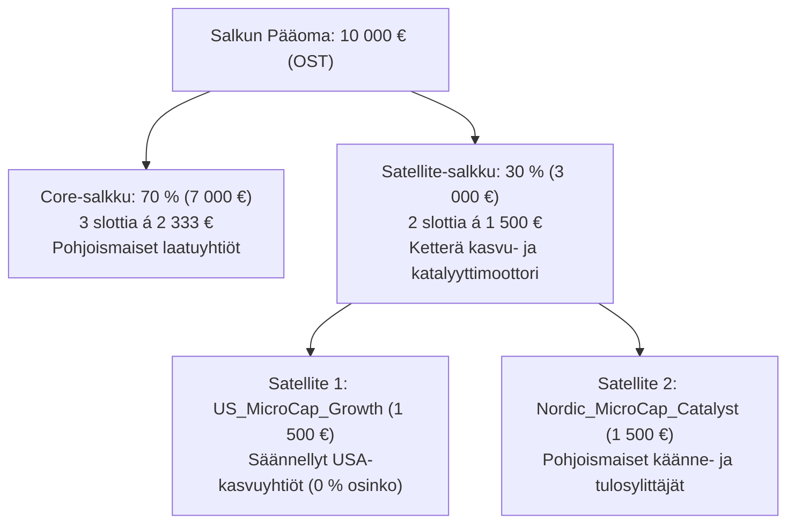
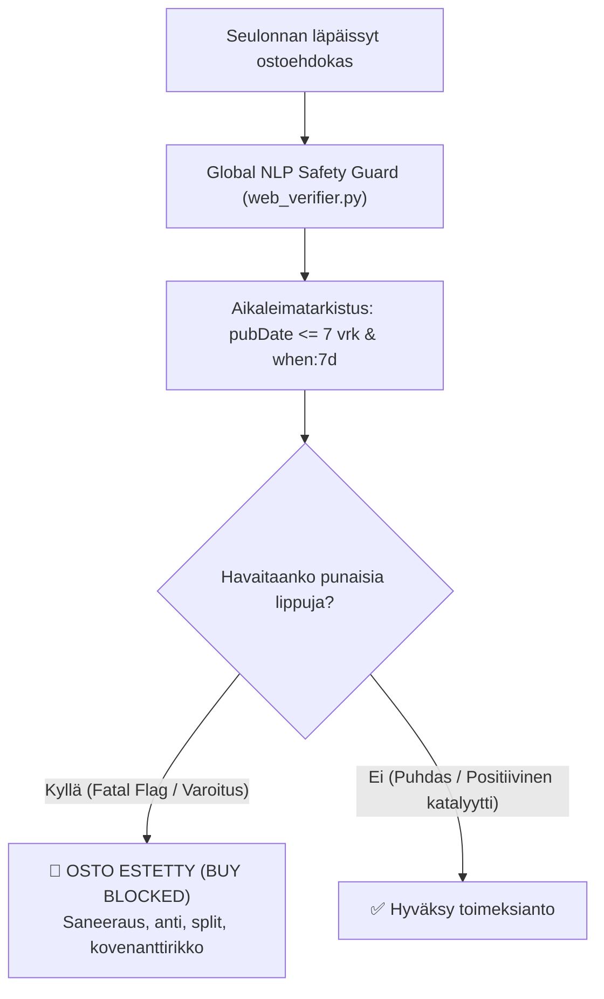

# 🛰️ Satellite-skannerin Arkkitehtuuri- ja Toimintakatselmointi

Tämä dokumentti kokoaa yhteen **tradeBotTiukun** Satellite-skannerin toimintaperiaatteet, seulontakriteerit, riskirajaukset ja exit-säännöt live-kaupankäynnin katselmointia varten.

---

## 📌 1. Strateginen Konteksti: Hybrid Core-Satellite (`P13_Live_Candidate`)

Järjestelmän live-kandidaattisalkku (`P13_Live_Candidate`) on mitoitettu **10 000 euron osakesäästötilille (OST)** hyödyntäen Core-Satellite -pääomanallokaatiota:



* **Core (70 %)**: Matala kiertonopeus, kvartaalitason fundamenttiarviointi, pitkän aikavälin laadukkaat arvonkasvattajat.
* **Satellite (30 %)**: Korkeampi alfa ja tuottopotentiaali, tiukat kvantitatiiviset suojastopit, nopea voittojen kotiutus ja 45 päivän aikarajat.

---

## 🔍 2. Satellite-alastrategioiden Seulontakriteerit

### 2.1 Satellite 1: `US_MicroCap_Growth` (15 % / 1 500 €)

Kohdistuu Yhdysvaltain markkinan nopeasti skaalautuviin pienyhtiöihin huomioiden suomalaisen osakesäästötilin lainsäädännölliset ja verotukselliset rajoitteet:

* **Pörssiraja**: **Tiukasti vain NASDAQ tai NYSE**. Kaikki OTC-, Pink Sheet- ja OTCQB/QX -pinkkarilistat hylätään automaattisesti (`DISALLOWED_US_EXCHANGES`).
* **Markkina-arvo**: **$30\text{ M} \le \text{Market Cap} \le 350\text{ M USD}$** (rajaa pois mikrolikvidit alle 30M penniosakkeet sekä raskaat keskisuuret).
* **Osinkorajoitus (OST-verosuoja)**: **$\text{Dividend Yield} == 0.0\,\%$**.
  > [!IMPORTANT]
  > Yhdysvaltalaisista osingoista peritään 15 % lähdevero Yhdysvalloissa, jota ei pysty hyvittämään Suomen verotuksessa OST-tilillä. Tämän vuoksi skanneri hyväksyy vain osinkoa maksamattomat yhtiöt, jolloin koko tuotto realisoituu 100 %:sti verovapaana kurssinousuna tilin sisällä.
* **Kasvukatalyytti**: 
  * Liikevaihdon kasvu YoY $> 15.0\,\%$ **TAI**
  * Profile A -laatustatus **TAI**
  * Korkea NLP-tulosjulkistuksen konsensus (`STRONG BUY`).

---

### 2.2 Satellite 2: `Nordic_MicroCap_Catalyst` (15 % / 1 500 €)

Keskittyy Helsingin (OMXH), Tukholman (OMXS) ja First Northin pienten yhtiöiden tuloskäänteisiin ja kaupallisiin läpimurtoihin:

* **Markkina-arvo**: **$15\text{ M} \le \text{Market Cap} < 150\text{ M EUR}$**.
* **Kelpoisuusehdot (joko/tai)**:
  1. **Fundamenttilaatu**: Täyttää valmiiksi `Profile A` (kasvu/kannattavuus) tai `Profile B` (Deep Value / tasepohja) kriteerit.
  2. **Käännekatalyytti (`WATCH_TURNAROUND`)**:
     * Todettu tuore positiivinen uutiskatalyytti (suurtilaus, yrityskauppa, tulosvaroitus ylöspäin).
     * **Kassariittävyys $\ge 12\text{ kk}$**: Yhtiöllä on oltava todistettavasti vähintään vuoden kassa orgaanisella polttovauhdilla.
     * **Likviditeettivarmistus**: 20 päivän keskivaihto $\text{ADV} \ge 20\,000\text{ €}$ tai päivävaihto $\ge 2\,000\text{ kpl}$.

---

## 🛡️ 3. Reaaliaikainen NLP- ja Uutisturvasulku (`screener/web_verifier.py`)

Kaikille kandidaateille ajetaan ennen toimeksiannon luontia reaaliaikainen uutistutka.



1. **Tiukka Tuoreustarkistus (`max_age_days: 7`)**:
   * Google News RSS -syötteen hakulauseke rajataan muodossa `when:7d`.
   * Jokaisen uutisartikkelin RFC 2822 `<pubDate>` parsitaan ja verrataan kellonaikaan. Yli 7 päivää vanhat uutiset (kuten kuukausien takaiset vanhat annit) suodatetaan pois.
2. **Kovat Turvaportit (`FATAL RED FLAGS`)**:
   * **Suomi**: Saneerausmenettely, yrityssaneeraus, konkurssi, kovenanttirikko, Finanssivalvonnan tutkinta.
   * **Ruotsi**: Kontrollbalansräkning, företagsrekonstruktion, konkurs, riktad emission, kraftig utspädning.
   * **USA**: Chapter 11, liquidation, toxic convertible, going concern warning, SEC investigation.
3. **Käänteissplittisuoja**:
   * Suodattaa pois keinotekoiset kurssipomput ja pakkoyhdistelyt (`reverse stock split`, `share consolidation`, `sammanläggning av aktier`).

---

## ⚡ 4. Kaupankäynti- ja Toimeksiantorajoitteet (Execution Rules)

* **Toimeksiantotyyppi**: **Aina `LIMIT`**. Markkinahintaiset toimeksiannot (`MARKET`) on ehdottomasti estetty huonojen laitojen aiheuttaman liukuman eliminoimiseksi.
* **Limit-hintalaskenta**: `Ostolimiitti = Päätöskurssi * (1.0 + 0.002)` (+0.2 % puskuri).
* **Markkinavaikutusrajoitin (`MAX_ADV_ALLOCATION_PCT = 0.05`)**: 
  * Kertaosto ei saa ylittää **5 % osakkeen 20 päivän keskivaihdosta (ADV)**. Mikäli slottikoko (1 500 €) ylittäisi tämän, toimeksiannon kokoa pienennetään automaattisesti.
* **Valuuttamuunnokset**: Automaattinen EKP-keskikurssimuunnos (USD, SEK, DKK, NOK $\rightarrow$ EUR) ilman manuaalisia laskutoimituksia.

---

## 🚪 5. Myynti- ja Riskienhallintastrategia (Exit Management)

Satellite-positioilla on tiukat kvantitatiiviset säännöt, jotka suojaavat pääomaa ja kotiuttavat voitot automaattisesti:

| Sääntö | Parametri / Raja | Toimintalogiikka ja Perustelu |
| :--- | :--- | :--- |
| **Stop-Loss** | **-12.0 %** (tai 2.5x ATR) | Sulkee koko position välittömästi ostotasosta pääoman suojaamiseksi. |
| **Time-Stop (Dead Money)** | **45 pörssipäivää** | Jos osake ei ole 45 kaupankäyntipäivän kuluessa noussut vähintään **+5.0 %**, positio myydään pois pääoman vapauttamiseksi parempiin kohteisiin. |
| **Partial Take-Profit** | **+25.0 % tuotto** | **Myy tasan 50 % positiosta**, jolloin alkupääoma kotiutetaan ja tuotot lukitaan. |
| **Runner Break-Even** | Voitonkotiutuksen jälkeen | Suojastoppi nostetaan **Break-Eveniin (0.0 %)** $\rightarrow$ kauppa ei voi enää muuttua tappiolliseksi. |
| **Runner Trailing-Stop** | Voitonkotiutuksen jälkeen | Jäljellä olevalle 50 %:lle kytketään **-15.0 % liukuva trailing stop** huippukurssista (`HighestPrice`). |

---

## 💻 6. Katselmointi- ja Testikomennot

Ennen live-automaation aktivointia Satellite- ja Core-salkun tilanteen voi ajaa ja tarkastaa manuaalisesti:

```bash
# 1. Aja P13_Live_Candidate -salkun yksittäinen katselmointisykli (tulostaa ehdokkaat ja exitit ilman toimeksiantoja):
python main_controller.py --run-once --portfolio P13_Live_Candidate

# 2. Aja yksikkötestit ja varmista suodattimien toiminta:
python -m unittest tests/test_tiered_filters.py tests/test_web_verifier.py tests/test_multi_portfolio.py

# 3. Käynnistä Streamlit-hallintapaneeli salkkujen ja graafien visuaaliseen tarkasteluun:
streamlit run dashboard.py --server.port 8502
```
